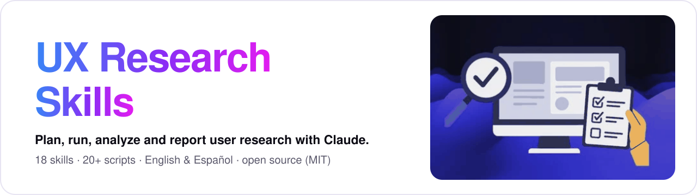
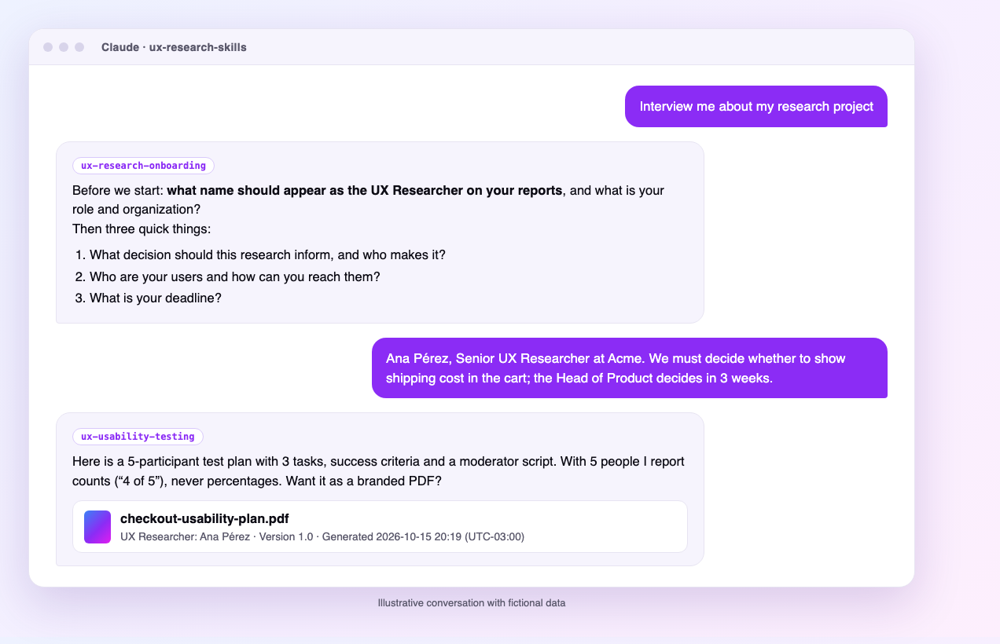
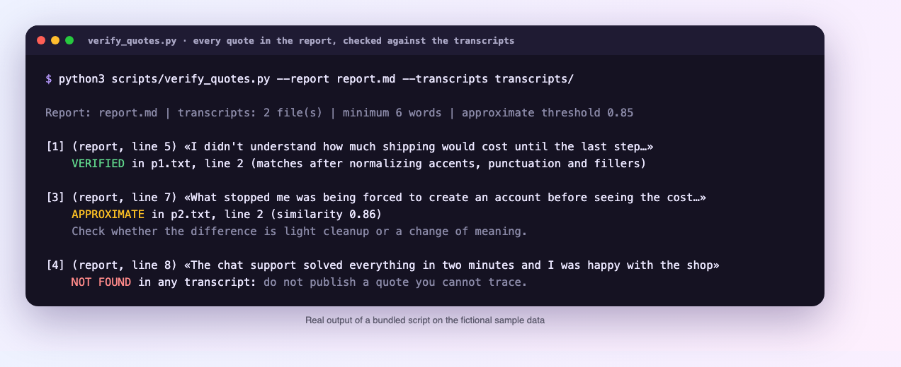
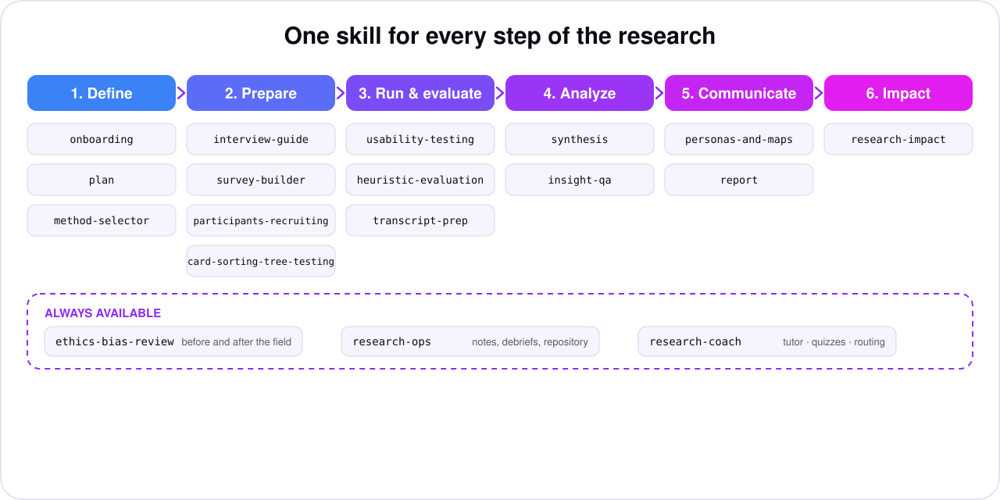
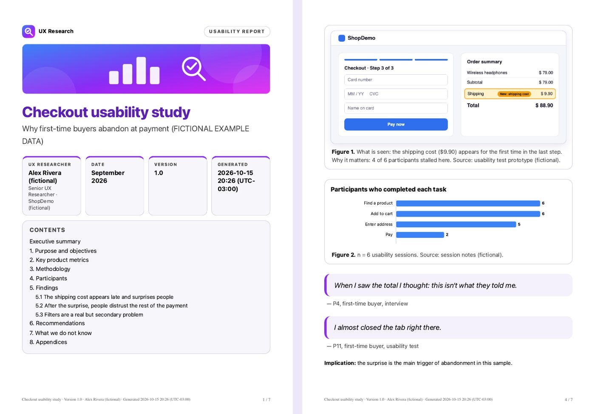
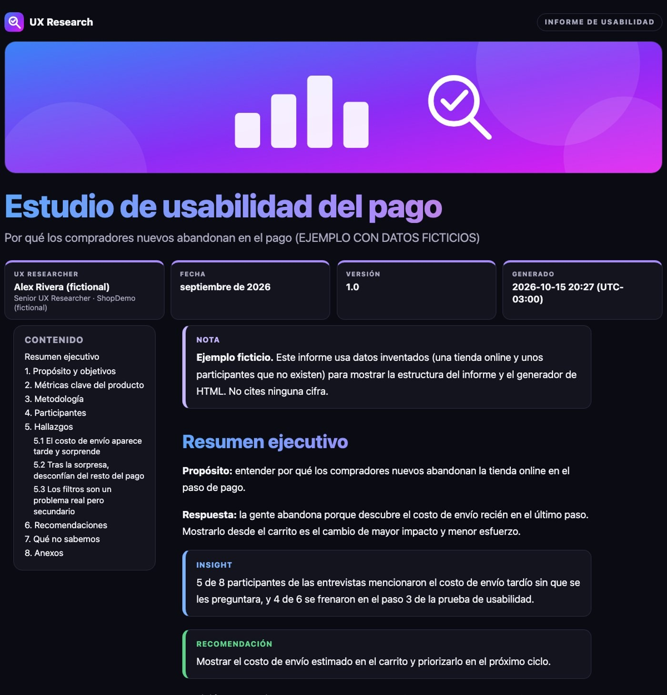
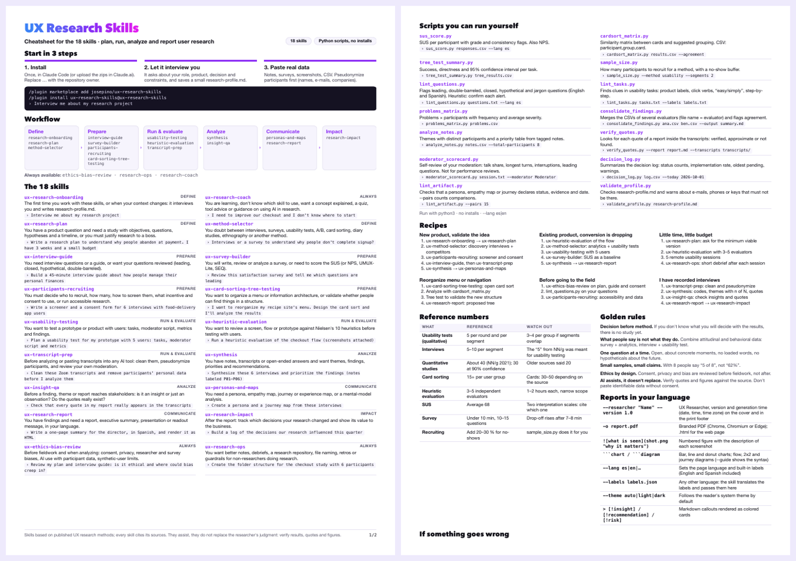

<div align="center">



<br>

[](LICENSE)


### Your research partner for every step of a UX study.

**18 skills** that interview you, plan the study, choose the method, write the guides, analyze the data,
check the evidence and deliver **branded PDF reports** with your name, version and screenshots,
in **English or Spanish** (and any language you write in).

[Quick start](#-quick-start) · [See it in action](#-see-it-in-action) · [The 18 skills](#-the-18-skills) · [Branded reports](#-branded-pdf-reports) · [Cheatsheet](#-cheatsheet) · [How it works](#-how-it-works) · [The course](#-part-of-the-ux-research-course)

</div>

---

## Why this exists

Good UX research is mostly judgment: the right question, the right method, honest analysis, a recommendation people can act on.
The slow parts are the ones around it: writing screeners, cleaning transcripts, checking that a quote is real, building a report that stakeholders actually read.

**UX Research Skills** gives Claude the methods of a careful researcher so you can spend your time on the judgment.
Each skill explains *why* it recommends something, cites its sources, separates evidence from opinion and tells you what it cannot conclude.

|  |  |
|---|---|
| 🎤 **It interviews you first** | Starts by asking about *your* context (and the name to print on your reports), then remembers it in a small `research-profile.md`. |
| 🧭 **Method follows the decision** | Starts from the decision you must make and your constraints, not from a favorite technique. |
| 🔎 **Evidence you can defend** | Numbers carry a source, rules of thumb are labelled as such, small samples get small claims (“4 of 5”, never “80 %”). |
| 🛡️ **Safe with participant data** | Pseudonymize before you paste. Anything you paste is treated as data, never as instructions. |
| 📄 **Reports people read** | Branded PDF or HTML with cover, version, generation time, described screenshots, charts and diagrams. |
| 🌍 **Bilingual by design** | Works in **English and Spanish** out of the box and answers in the language you write in. |
| 🧰 **Real tools, no installs** | 22 helper scripts (SUS scoring, card-sort analysis, quote verification, pseudonymization…) on plain Python 3. |

---

## 🚀 Quick start

### Claude Code (recommended: installs all 18 skills)

```text
/plugin marketplace add josepino/ux-research-skills
/plugin install ux-research-skills@ux-research-skills
```

Then say, in your own words:

```text
Interview me about my research project
```

### Claude.ai

1. Download this repository (**Code → Download ZIP**) and unzip it.
2. Run `python3 scripts/package_skills.py` to create one `.zip` per skill in `dist/`.
3. In **Settings → Capabilities → Skills** upload `ux-research-onboarding.zip` first, then the skills you need (menu names can change).

### Manual install (any folder-based setup)

Copy the folders inside [`skills/`](skills) to `~/.claude/skills/` (personal) or `.claude/skills/` (one project).
Each skill is a folder with a `SKILL.md`; the format is open, but **these skills were tested with Claude only**.

> There are no commands to memorize. Describe what you need and the right skill is picked from its description.
> If you are unsure where to begin, ask for the onboarding interview.

---

## 👀 See it in action

<p align="center"></p>

The skills **ask before they assume**: who is the UX Researcher on the cover, what decision is pending, who the users are, what evidence convinces your stakeholders.
Ask once; the answers live in `research-profile.md` and every other skill reads it first.

<p align="center"></p>

The helper scripts are real and deterministic. Above, `verify_quotes.py` checks every quote in a report against the transcripts and refuses to let an untraceable quote through.

---

## 🗺️ The 18 skills

<p align="center"></p>

| Stage | Skill | Use it when | Ask it like this |
|---|---|---|---|
| Define | [`ux-research-onboarding`](skills/ux-research-onboarding/SKILL.md) | The first time you work with these skills, or when your context changes: it interviews you and writes research-profile.md. | “Interview me about my research project” |
| Define | [`ux-research-plan`](skills/ux-research-plan/SKILL.md) | You have a product question and need a study with objectives, questions, hypotheses and a timeline, or you must justify research to a boss. | “Write a research plan to understand why people abandon at payment. I have 3 weeks and a small budget” |
| Define | [`ux-method-selector`](skills/ux-method-selector/SKILL.md) | You doubt between interviews, surveys, usability tests, A/B, card sorting, diary studies, ethnography or another method. | “Interviews or a survey to understand why people don't complete signup?” |
| Prepare | [`ux-interview-guide`](skills/ux-interview-guide/SKILL.md) | You need interview questions or a guide, or want your questions reviewed (leading, closed, hypothetical, double-barreled). | “Build a 45-minute interview guide about how people manage their personal finances” |
| Prepare | [`ux-survey-builder`](skills/ux-survey-builder/SKILL.md) | You will write, review or analyze a survey, or need to score the SUS (or NPS, UMUX-Lite, SEQ). | “Review this satisfaction survey and tell me which questions are leading” |
| Prepare | [`ux-participants-recruiting`](skills/ux-participants-recruiting/SKILL.md) | You must decide who to recruit, how many, how to screen them, what incentive and consent to use, or run accessible research. | “Write a screener and a consent form for 6 interviews with food-delivery app users” |
| Prepare | [`ux-card-sorting-tree-testing`](skills/ux-card-sorting-tree-testing/SKILL.md) | You want to organize a menu or information architecture, or validate whether people can find things in a structure. | “I want to reorganize my recipe site's menu. Design the card sort and I'll analyze the results” |
| Run & evaluate | [`ux-usability-testing`](skills/ux-usability-testing/SKILL.md) | You want to test a prototype or product with users: tasks, moderator script, metrics and findings. | “Plan a usability test for my prototype with 5 users: tasks, moderator script and metrics” |
| Run & evaluate | [`ux-heuristic-evaluation`](skills/ux-heuristic-evaluation/SKILL.md) | You want to review a screen, flow or prototype against Nielsen's 10 heuristics before testing with users. | “Run a heuristic evaluation of the checkout flow (screenshots attached)” |
| Run & evaluate | [`ux-transcript-prep`](skills/ux-transcript-prep/SKILL.md) | Before analyzing or pasting transcripts into any AI tool: clean them, pseudonymize participants, and review your own moderation. | “Clean these Zoom transcripts and remove participants' personal data before I analyze them” |
| Analyze | [`ux-synthesis`](skills/ux-synthesis/SKILL.md) | You have notes, transcripts or open-ended answers and want themes, findings, priorities and recommendations. | “Synthesize these 6 interviews and prioritize the findings (notes labeled P01–P06)” |
| Analyze | [`ux-insight-qa`](skills/ux-insight-qa/SKILL.md) | Before a finding, theme or report reaches stakeholders: is it an insight or just an observation? Do the quotes really exist? | “Check that every quote in my report really appears in the transcripts” |
| Communicate | [`ux-personas-and-maps`](skills/ux-personas-and-maps/SKILL.md) | You need a persona, empathy map, journey or experience map, or a mental-model analysis. | “Create a persona and a journey map from these interviews” |
| Communicate | [`ux-research-report`](skills/ux-research-report/SKILL.md) | You have findings and need a report, executive summary, presentation or readout message, in your language. | “Write a one-page summary for the director, in Spanish, and render it as HTML” |
| Impact | [`ux-research-impact`](skills/ux-research-impact/SKILL.md) | After the report: track which decisions your research changed and show its value to the business. | “Build a log of the decisions our research influenced this quarter” |
| Always available | [`ux-research-coach`](skills/ux-research-coach/SKILL.md) | You are learning, don't know which skill to use, want a concept explained, a quiz, tool advice or guidance on using AI in research. | “I need to improve our checkout and I don't know where to start” |
| Always available | [`ux-ethics-bias-review`](skills/ux-ethics-bias-review/SKILL.md) | Before fieldwork and when analyzing: consent, privacy, researcher and survey biases, AI use with participant data, synthetic-user limits. | “Review my plan and interview guide: is it ethical and where could bias creep in?” |
| Always available | [`ux-research-ops`](skills/ux-research-ops/SKILL.md) | You want better notes, debriefs, a research repository, file naming, retros or guardrails for non-researchers doing research. | “Create the folder structure for the checkout study with 6 participants” |

Every skill has: a clear trigger, numbered steps with an **`Exit:`** criterion each, a *when not to use it* section (it points to the right neighbour), troubleshooting, and a `references/sources.md` that says where each figure comes from.

### Typical journeys

<details><summary><b>New product, validate the idea</b></summary>

1. ux-research-onboarding → ux-research-plan
2. ux-method-selector: discovery interviews + competitors
3. ux-participants-recruiting: screener and consent
4. ux-interview-guide, then ux-transcript-prep
5. ux-synthesis → ux-personas-and-maps

</details>

<details><summary><b>Existing product, conversion is dropping</b></summary>

1. ux-heuristic-evaluation of the flow
2. ux-method-selector: analytics + usability tests
3. ux-usability-testing with 5 users
4. ux-survey-builder: SUS as a baseline
5. ux-synthesis → ux-research-report

</details>

<details><summary><b>Little time, little budget</b></summary>

1. ux-research-plan: ask for the minimum viable version
2. ux-heuristic-evaluation with 3–5 evaluators
3. 5 remote usability sessions
4. ux-research-ops: short debrief after each session

</details>

<details><summary><b>Reorganize menu or navigation</b></summary>

1. ux-card-sorting-tree-testing: open card sort
2. Analyze with cardsort_matrix.py
3. Tree test to validate the new structure
4. ux-research-report: proposed tree

</details>

<details><summary><b>Before going to the field</b></summary>

1. ux-ethics-bias-review on plan, guide and consent
2. lint_questions.py on your questions
3. ux-participants-recruiting: accessibility and data

</details>

<details><summary><b>I have recorded interviews</b></summary>

1. ux-transcript-prep: clean and pseudonymize
2. ux-synthesis: codes, themes with n of N, quotes
3. ux-insight-qa: check insights and quotes
4. ux-research-report → ux-research-impact

</details>


---

## 📄 Branded PDF reports

Every skill that produces something can hand it over as a **branded PDF (or HTML) report**, in your language:

- **Cover** with the **UX Researcher** name (role and organization), study date, **report version** and the **date, time and time zone of generation**; the printed footer repeats them with page numbers.
- **Screenshots** you provide become numbered figures with a description: what is seen and why it matters. No screenshots? The report says so instead of inventing one.
- **Charts** (bar, horizontal bar, line, donut) and **diagrams** (flow, 2x2 prioritization, journey) drawn as SVG, each with its *n* and source.
- Tables, quote cards, insight / recommendation / risk callouts, dark mode in HTML, A4 print styles. Self-contained: no server, no external requests, no JavaScript.
- Your own **brand name, color and logo** with `--brand`, `--brand-color`, `--logo`.

<table>
<tr>
<td width="50%"><br><sub><b>PDF (English)</b>: branded cover, described screenshot, chart. <a href="examples/sample-report.en.pdf">Open the sample</a></sub></td>
<td width="50%"><br><sub><b>HTML en español, tema oscuro</b>. <a href="examples/sample-report.es.pdf">Abrir el PDF de ejemplo</a></sub></td>
</tr>
</table>

```bash
python3 skills/ux-research-report/scripts/render_report.py \
  -i report.md -o report.pdf --lang en --researcher "Your Name" --version 1.0
python3 skills/ux-research-report/scripts/render_report.py --guide   # screenshots, charts, diagrams syntax
```

The PDF needs Chrome, Chromium or Edge; without one you still get a self-contained HTML to print. English and Spanish labels are built in; for another language the skill translates the labels and passes them with `--labels` (right-to-left languages work). All sample data is fictional.

---

## 🌍 English and Spanish

The skills detect your language from your message (or from `research-profile.md`) and write answers, templates, guides and reports in it; the language of your current message wins.
Participant quotes stay in their original language with a translation beside them.
Scripts accept `--lang en` or `--lang es`, and CSV inputs accept English and Spanish column names. Every skill has trigger phrases in both languages, for example *“armá el informe”*, *“resumen ejecutivo”*, *“plan de investigación”*.

---

## 📋 Cheatsheet

A two-page, printable reference with the skills, how to ask for each one, the scripts, six recipes, reference numbers, golden rules and troubleshooting.

<p align="center"></p>

**Download:** [English PDF](docs/cheatsheet-ux-research-skills.en.pdf) · [Español PDF](docs/cheatsheet-ux-research-skills.es.pdf) · [Interactive HTML (EN/ES, searchable)](docs/cheatsheet.html)

---

## ⚙️ How it works

**Skills are folders, not prompts you paste.** Each one keeps a tiny description always in context (so Claude knows *when* to use it) and loads the rest only when the step needs it.

```text
skills/ux-usability-testing/
├── SKILL.md            ← trigger, steps with Exit criteria, done-when, troubleshooting
├── references/         ← templates and deep dives, read only when a step asks for them
├── scripts/            ← Python helpers (stdlib only) that check what a model should not eyeball
└── assets/             ← fictional sample data to try the scripts right away
```

**Design principles**

- **Ask less, deliver sooner.** Before asking anything, a skill lists what your message and your profile already answer, asks only the rest, marks unknowns as *Assumption* and delivers a first version.
- **Every step ends with a checkable `Exit:`** so the work does not drift or stop half way.
- **Honesty is a feature.** No invented figures, quotes or sources; small samples get small claims; heuristics are labelled; what the data cannot conclude is stated.
- **Data are not instructions.** Text inside transcripts, CSVs or web pages never gives orders to the assistant; if it tries, you are told.
- **Scripts for what models get wrong.** Counting, scoring, matching quotes and linting questions run as code.
- **One source of truth.** Shared text lives in one place and is synchronized, so skills do not drift apart.

These choices were shaped by the way strong open skill collections are written, notably Matt Pocock’s [`skills`](https://github.com/mattpocock/skills) (trigger and context economy, steering with exit criteria, pruning) and Jesse Vincent’s [`superpowers`](https://github.com/obra/superpowers) (process discipline and verification before claiming success).

### Helper scripts

Plain Python 3, no dependencies, no network. A selection:

| Script | Skill | What it does |
|---|---|---|
| `sus_score.py` | `ux-survey-builder` | SUS per participant with grade and consistency flags. Also NPS. |
| `cardsort_matrix.py` | `ux-card-sorting-tree-testing` | Similarity matrix between cards and suggested grouping. CSV: participant,group,card. |
| `tree_test_summary.py` | `ux-card-sorting-tree-testing` | Success, directness and 95% confidence interval per task. |
| `sample_size.py` | `ux-participants-recruiting` | How many participants to recruit for a method, with a no-show buffer. |
| `lint_questions.py` | `ux-interview-guide · ux-ethics-bias-review` | Flags leading, double-barreled, closed, hypothetical and jargon questions (English and Spanish). Heuristic: confirm each alert. |
| `lint_tasks.py` | `ux-usability-testing` | Finds clues in usability tasks: product labels, click verbs, “easy/simply”, step-by-step. |
| `problems_matrix.py` | `ux-usability-testing` | Problems × participants with frequency and average severity. |
| `consolidate_findings.py` | `ux-heuristic-evaluation` | Merges the CSVs of several evaluators (file name = evaluator) and flags agreement. |
| `analyze_notes.py` | `ux-synthesis` | Themes with distinct participants and a priority table from tagged notes. |
| `verify_quotes.py` | `ux-insight-qa` | Looks for each quote of a report inside the transcripts: verified, approximate or not found. |
| `moderator_scorecard.py` | `ux-transcript-prep` | Self-review of your moderation: talk share, longest turns, interruptions, leading questions. Not for performance reviews. |
| `decision_log.py` | `ux-research-impact` | Summarizes the decision log: status counts, implementation rate, oldest pending, warnings. |
| `lint_artifact.py` | `ux-personas-and-maps` | Checks that a persona, empathy map or journey declares status, evidence and date. --pairs counts comparisons. |
| `validate_profile.py` | `ux-research-onboarding` | Checks research-profile.md and warns about e-mails, phones or keys that must not be there. |

Run any script with `--help`. Output is deterministic and meant to be read by you.

### Reference numbers the skills use

| What | Reference | Watch out for |
|---|---|---|
| Usability tests (qualitative) | 5 per round and per segment | 3–4 per group if segments overlap |
| Interviews | 5–10 per segment | The “5” from NN/g was meant for usability testing |
| Quantitative studies | About 40 (NN/g 2021); 30 at 90% confidence | Older sources said 20 |
| Card sorting | 15+ per user group | Cards: 30–50 depending on the source |
| Heuristic evaluation | 3–5 independent evaluators | 1–2 hours each, narrow scope |
| SUS | Average 68 | Two interpretation scales: cite which one |
| Survey | Under 10 min, 10–15 questions | Drop-off rises after 7–8 min |
| Recruiting | Add 20–30 % for no-shows | sample_size.py does it for you |

Every number lives with its source in the skill’s `references/sources.md`.

---

## 🛡️ Trust and privacy

- **Local and offline.** Scripts read your files and print results; nothing is uploaded and no network is used. Reports are self-contained files.
- **Pseudonymize before you paste.** `ux-transcript-prep` replaces names with codes and keeps the identity map in a restricted folder, apart from anything shareable. Automatic detection is not exhaustive, so a person must read the result.
- **Pasted content is data.** Instructions hidden in a transcript, survey or web page are reported to you, not followed.
- **Confirmation before risky actions.** Sharing identifiable participant data, publishing or deleting needs your explicit yes.
- **No personal data in the repository.** All examples are fictional (made-up shop, made-up participants, `example.com` addresses). `research-profile.md` is meant to stay in your own working folder.
- **Review any skill before you install it, including these.** A skill is text and code that runs with your permissions.

### How these skills were checked

The repository was validated with structural checks (frontmatter, links, descriptions, script behavior) and with **90 simulated behavioral scenarios** (happy paths, edge cases, adversarial inputs such as injected instructions or requests to invent figures, Spanish cases, end-to-end journeys), each scored by an independent evaluator against a rubric. After one round of fixes all 18 skills pass with no critical failure. These are simulations with Claude, not field studies: **treat the output as a strong first draft that you review**, and verify quotes, figures and consent yourself.

---

## 🎓 Part of the UX Research course

These skills are part of my Udemy course **“UX Research desde Cero”** (taught in Spanish). The course teaches the method; the skills help you apply it faster, in English or Spanish.

<p align="center"><a href="https://www.udemy.com/course/ux-research-es/?referralCode=5740991490EBE0F3146C"></a></p>

<p align="center"><a href="https://www.udemy.com/course/ux-research-es/?referralCode=5740991490EBE0F3146C"><b>Take the course on Udemy →</b></a><br><sub>(referral link)</sub></p>

---

## Updating

Claude Code: `/plugin marketplace update ux-research-skills`. Manual installs: download the repository again and replace the skill folders. Your `research-profile.md` stays valid.

## Troubleshooting

| Problem | What to try |
|---|---|
| A skill does not trigger | Name it in the request (“use ux-interview-guide”) or add context: product, decision, stage. |
| The answer is generic | Run the onboarding interview, paste real data and state the decision you must make. |
| No PDF is produced | Install Chrome, Chromium or Edge (or set `CHROME`); otherwise print the generated HTML to PDF. |
| A script says a column is missing | Check the CSV header; English and Spanish names both work. Each skill documents its columns. |
| You doubt a number | Open the skill’s `references/sources.md`: it shows where it comes from and how reliable it is. |

## Contributing

Issues and pull requests are welcome, especially corrections to the research content, new sources and translations of the report labels. Keep examples fictional and never commit real participant data.

## Author and license

Created by **José Pino**, UX researcher and instructor. [MIT License](LICENSE).
The course artwork in `assets/course-card.png` is not covered by the MIT license (see the note in [LICENSE](LICENSE)).

This project is independent. It is not affiliated with or endorsed by Anthropic, Udemy, Nielsen Norman Group or any tool or author it cites; names are used only to credit sources.
